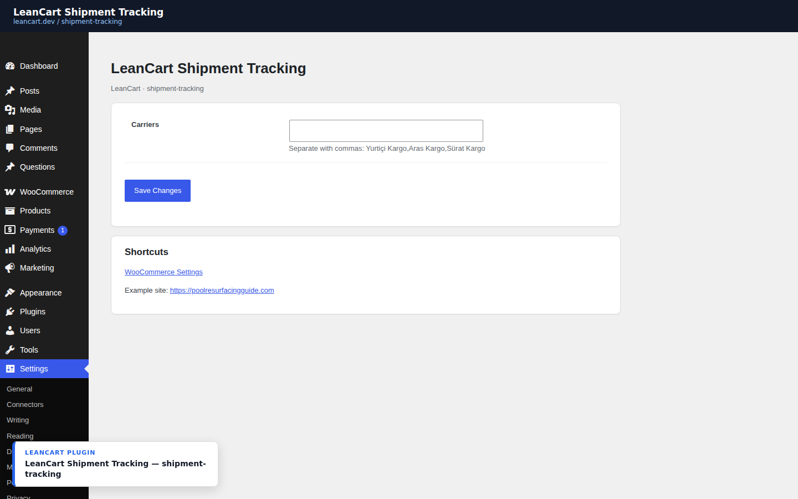
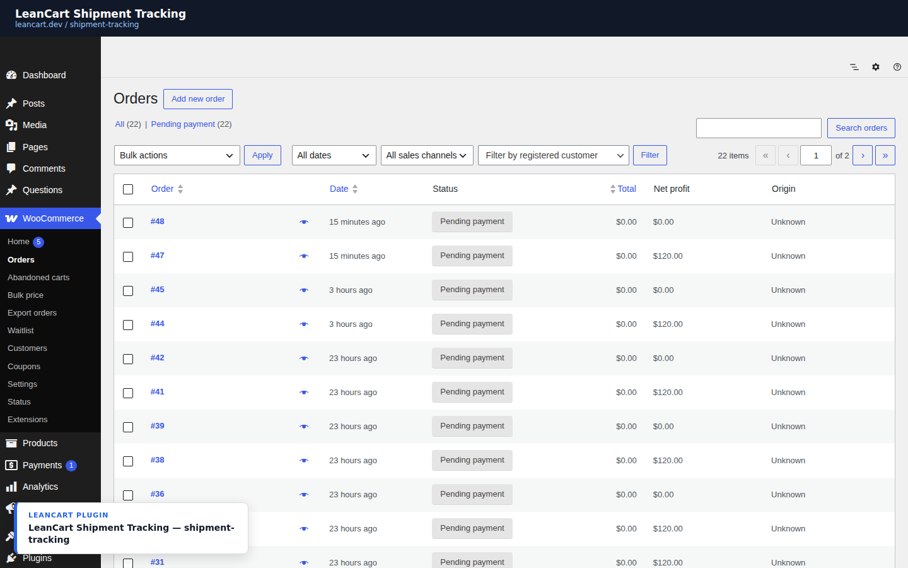
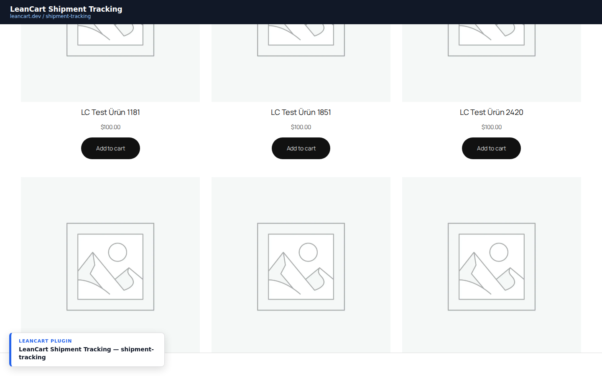

# LeanCart Shipment Tracking

Adds a carrier and tracking number to an order and shows it to the customer.

**Example site:** https://poolresurfacingguide.com
**Category:** Shipping · **License price:** $21 (Business Bundle: $149)

## Features
* Carrier selection
* Tracking number field
* Display on the My Account page
* Automatic addition to emails

## Installation
1. Download the ZIP from `build/zips/` or download this repository as a ZIP.
2. In WordPress Admin, go to Plugins → Add New → Upload Plugin.
3. Activate the plugin and configure it at **Settings → LeanCart Shipment Tracking**.

## Requirements
- WordPress 6.2+, PHP 8.0+
- WooCommerce 8+ (HPOS compatible)

## Screenshots

| Settings page | Related admin screen | Store front end |
|---|---|---|
|  |  |  |

## License
GPLv2 or later — see `LICENSE.txt` for details.

---
LeanCart · 30 single-purpose WooCommerce plugins · https://github.com/imamalkan-hub
